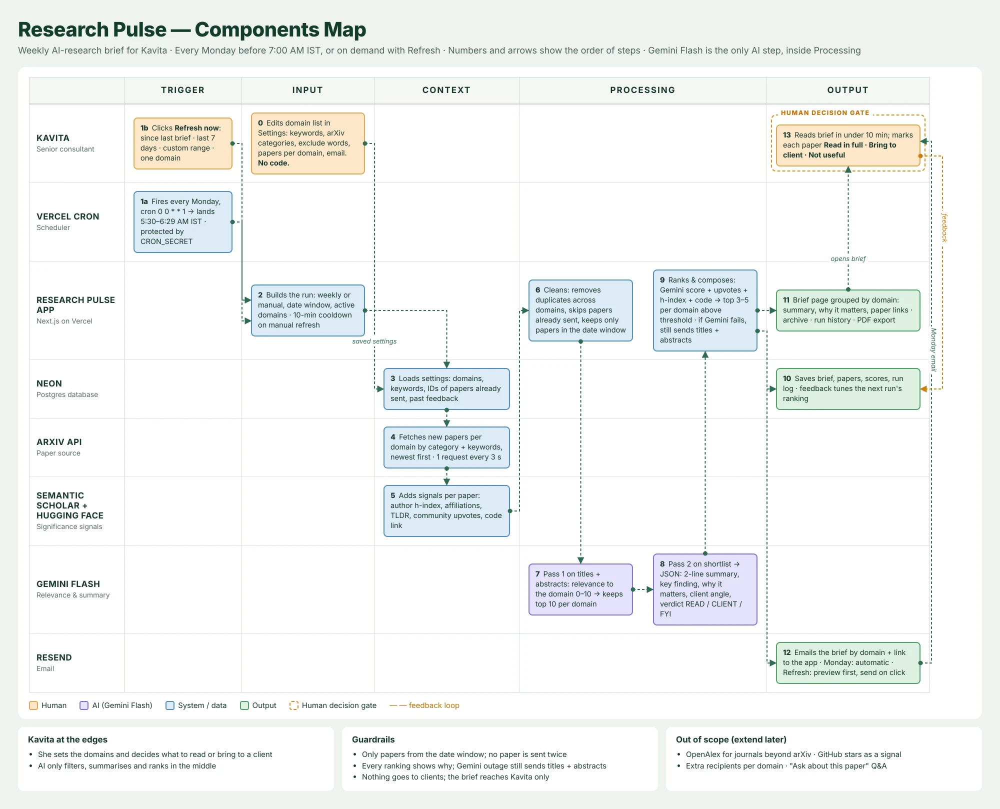

# Research Pulse

A weekly AI-research brief for Kavita, a senior consultant who advises clients on AI strategy. Every Monday before 7:00 AM IST it scans her monitored domains on arXiv, adds significance signals from Semantic Scholar and Hugging Face, has **Gemini Flash** triage and summarise the papers, ranks them, and emails a brief she can read in under 10 minutes. The same brief is on the web, where she marks each paper *Useful* or *Not useful* and bookmarks the ones she wants to keep. That feedback shapes the next week's ranking.

**Design:** light, blue-led "research newsletter" look from the Claude Design handoff — Plus Jakarta Sans + Inter, tokens in `app/globals.css`, icons from Lucide, logo in `public/rp-mark.png`.

**Stack:** Next.js 16 (App Router, TypeScript) · Tailwind · Neon Postgres · Google Gemini Flash (`@google/genai`) · Resend · Vercel Cron. Everything runs on free tiers. Gemini is the only AI used; there is no Claude/Anthropic API anywhere in the code.



The full spec is in [`docs/PRD.md`](docs/PRD.md).

## How a run works

```
Trigger (Monday cron or Refresh) → load settings, domains, sent-paper IDs, feedback   [Neon]
  → fetch each domain, newest first, 1 request every 3.1 s                            [arXiv]
  → clean: date window, exclude words, drop papers already delivered or marked Not useful
  → enrich: author h-index, affiliations, TLDR / upvotes, code links                   [S2, HF]
  → Pass 1: relevance 0–10 per paper → top 10 per domain                              [Gemini]
  → Pass 2: summary, key finding, why it matters, client angle, verdict, significance [Gemini]
  → score = weighted Gemini significance + relevance + upvotes + h-index + code + watch-list
  → threshold, per-domain slots, reading-time cap, cross-domain dedupe
  → headline of the week                                                               [Gemini]
  → save brief + run log                                                               [Neon]
  → email (cron always; Refresh only if you ask)                                       [Resend]
```

Key code: [`lib/pipeline.ts`](lib/pipeline.ts) (orchestration), [`lib/ranking.ts`](lib/ranking.ts) (scoring), [`lib/analysis.ts`](lib/analysis.ts) (prompts and schemas), [`lib/arxiv.ts`](lib/arxiv.ts), [`lib/signals.ts`](lib/signals.ts), [`lib/email.ts`](lib/email.ts).

### Guardrails
- Only papers inside the date window are used, and no paper is delivered twice.
- Every card shows **why it was ranked** (Gemini's reasons, h-index, upvotes, code, watch-list matches).
- If Gemini is down or the key is invalid, the brief still goes out. It lists titles and abstracts (or the S2 TLDR), ranked by signals, with a visible notice.
- One domain failing doesn't fail the run: the run is marked *partial*, and the domain can be retried from **Runs**.
- A time guard at 240 s finalises whatever is done, which keeps the run under Vercel's 300 s limit.
- Gemini results are cached per (paper, domain, prompt version), so re-runs don't spend quota again.
- The brief goes to Kavita only. Nothing is sent to clients.

## Pages
| Route | What it does |
|---|---|
| `/` | Latest brief, Refresh panel (since last brief · last N days · custom range · selected domains · optional email), trends |
| `/briefs/[id]` | Full brief with feedback (Useful · Not useful · Bookmark), notes and client tags on bookmarks, Export PDF, Copy Markdown, Send email, Mark as delivered |
| `/briefs` | Past briefs. Search across titles, summaries and notes; filter by domain and verdict |
| `/bookmarks` | Bookmarked papers with notes and client tags (her running log). `/library` redirects here |
| `/runs` | Run history: status, duration, counts, Gemini calls, per-domain status, Retry |
| `/settings` | Add, edit, pause and delete domains, with a **Preview query** test against arXiv; global preferences; pause delivery |

## Setup

```bash
npm install
cp .env.example .env.local   # fill in the values below
npm run db:migrate           # creates tables (idempotent)
npm run db:seed              # settings row + 4 starter domains
npm run dev
```

Other scripts: `npm test` (Vitest), `npx tsx scripts/run-once.ts [domainId…]` (run the pipeline locally), `npx tsx scripts/show-brief.ts` (print the latest brief as Markdown).

### Environment variables
| Variable | Required | Where to get it |
|---|---|---|
| `DATABASE_URL` | yes | console.neon.tech → project → **Connect** → *pooled* connection string |
| `GEMINI_API_KEY` | yes | aistudio.google.com → **Get API key** |
| `GEMINI_MODEL` | yes | The newest *Flash* model listed in AI Studio. Default `gemini-3.8-flash` (`gemini-2.5-flash` no longer works for new keys) |
| `RESEND_API_KEY` | yes | resend.com → **API Keys** → Create (sending access) |
| `DEFAULT_RECIPIENT` | yes | The email you signed up to Resend with (required while sending from `onboarding@resend.dev`) |
| `CRON_SECRET` | yes | `openssl rand -hex 32`. Vercel sends it as `Authorization: Bearer …` |
| `APP_URL` | yes | Production URL, no trailing slash. Used for the email's links |
| `EMAIL_FROM` | no | Default `Research Pulse <onboarding@resend.dev>`. Change it only after verifying a domain in Resend |
| `S2_API_KEY` | no | semanticscholar.org/product/api. The app works without a key (shared rate limit) |
| `ADMIN_PASSCODE` | no | If set, Settings, Refresh, Send and Feedback need this passcode (30-day cookie). Reading briefs stays public. If unset, everything is open |
| `SESSION_SECRET` | if passcode | `openssl rand -hex 32` |
| `TEST_MODE` | no | `true` turns off the refresh cooldown, shows a TEST badge and emails only `DEFAULT_RECIPIENT`. Use `false` in production |
| `MOCK_GEMINI` | no | `true` returns deterministic fake AI output (UI work without spending quota). **Must be false in production** |

arXiv and Hugging Face need no key.

## Deploying to Vercel
1. Push this folder to a public GitHub repo, then go to Vercel → **Add New → Project** and import it.
2. Add all the env vars above under **Production**. Set `APP_URL` to the deployment URL.
3. Deploy. Run `npm run db:migrate && npm run db:seed` locally against the same `DATABASE_URL` if you haven't already.
4. Check `/api/health`. Then click **Refresh** on `/`, open the brief and click **Send email**.
5. Trigger the cron once: Vercel → Settings → Cron Jobs → **Run**. Or:
   `curl -H "Authorization: Bearer $CRON_SECRET" https://<app>/api/cron/weekly-brief`

### Changing the schedule
On the Hobby plan, cron schedules are fixed at deploy time and run at most once a day, firing somewhere inside the scheduled hour. The schedule lives in [`vercel.json`](vercel.json):
```json
{ "crons": [{ "path": "/api/cron/weekly-brief", "schedule": "0 0 * * 1" }] }
```
`0 0 * * 1` is Monday 00:00 UTC, so the email arrives between 5:30 and 6:29 AM IST. To change it, edit the expression (it's in UTC) and redeploy. To skip a week, use **Pause Monday delivery** in Settings. The next run then covers everything since the last delivered brief.

## Feedback model
| Control | Effect |
|---|---|
| **Useful** | "More like this": used as a positive example for Gemini in that topic and toward the +0.5 author boost |
| **Not useful** | The paper never appears again, and it is used as a negative example. Removes any bookmark |
| **Bookmark** | Saves the paper to **Bookmarks**, where it can carry a note and client tag. Also counts as Useful. Clears Not useful |

The **READ / CLIENT / FYI** badges are the AI's suggestions ("Suggested: Read in full / Share with client / FYI"). They are advice only and do not change the score.

## Design decisions & simplifications
- **Since last brief** starts at the end of the last *delivered* brief. Preview briefs from Refresh don't count until you email them or click *Mark as delivered*, so their papers can still show up on Monday.
- Pass 1 triages at most 120 candidates per domain (3 Gemini calls). The candidates are pre-sorted by keyword hits and upvotes. This keeps busy domains such as AI Agents inside the free-tier quota and the time budget.
- If the date-filtered arXiv query returns nothing, the app falls back to a date-sorted query and filters by date on its own side.
- If a source is unavailable, its ranking weight is shared out among the other signals in proportion to their weights.
- Thinking is set to `LOW` on Gemini 3.x Flash models so each call stays around 10–20 s.
- When a domain has nothing above the threshold, the brief shows "Quiet week" with the best candidate collapsed under **Closest miss**. That candidate doesn't count as delivered.
- Deleting a domain archives it: future briefs skip it, past briefs keep its papers. Adding a domain with the same name later restores it.
- Cache Components is turned off. Every page reads live data from Neon, so the routes use `dynamic = "force-dynamic"`.
